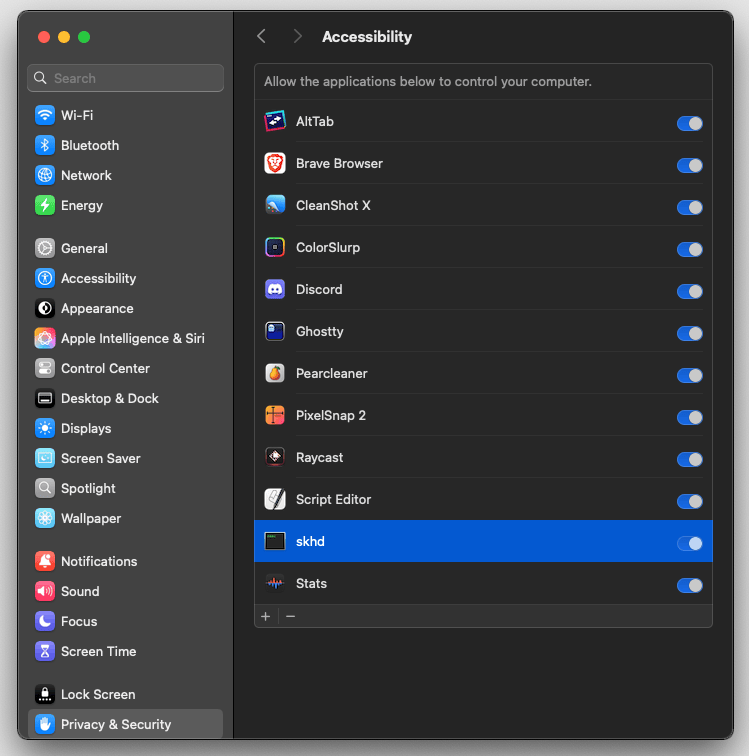

# How to disable Apple Music from launching on media keys and make them only work with Spotify

👉 ORIGINAL GIST POST: https://gist.github.com/rokartur/5e6ff8556c90a9eaaf010834181dfbd4

This solution forces media keys to work only for Spotify.

> [!NOTE]
> Homebrew, one formula, one config file, zero additional apps.

### 1. Open terminal

### 2. Disable Apple Music for media keys
Enter the following commands in the terminal:
```shell
sudo launchctl stop com.apple.rcd
sudo launchctl disable gui/$(id -u)/com.apple.rcd
```

To verify that it works, type this:
```shell
sudo launchctl print-disabled gui/$(id -u)
```

You should see something like this among the disabled services
```
"com.apple.rcd" => disabled
```

### 3. Install [Homebrew](https://brew.sh/)
```shell
/bin/bash -c "$(curl -fsSL https://raw.githubusercontent.com/Homebrew/install/HEAD/install.sh)"
```

### 4. Install [skhd](https://github.com/koekeishiya/skhd)
```shell
brew install koekeishiya/formulae/skhd
```

### 5. skhd in login items
```shell
skhd --start-service
```

### 6. Configure media keys
If you don't have create config file
```shell
touch ~/.skhdrc
```
```shell
open ~/.skhdrc 
```
Paste this and save:
```
play : osascript -e 'tell application "Spotify" to playpause' 
previous : osascript -e 'tell application "Spotify" to previous track'
next : osascript -e 'tell application "Spotify" to next track'
```
or
```
play : osascript -e 'tell application "Spotify" to playpause' 
rewind : osascript -e 'tell application "Spotify" to previous track'
fast : osascript -e 'tell application "Spotify" to next track'
```

### 7. Reload config to be sure.
```shell
skhd -r
```

### 🎧 enjoy! If this was helpful to you, please leave a ⭐

# FAQ
If Spotify is turned off and you click the media buttons, will it turn on?
> YESSS!

---

Prev and Next button not working?
> Check:
>1. Both versions of config
>2. Make sure that skhd has Accessibility permissions in System Preferences → Privacy


--- 

## Troubleshooting: media keys do nothing (even Music doesn't react)

Since `rcd` is disabled, skhd is the only thing receiving the media keys. If nothing happens, skhd is most likely not running or lacks permissions.

### 1. Check if skhd is running and read its logs

```
pgrep -fl skhd
tail -n 30 /tmp/skhd_$USER.err.log /tmp/skhd_$USER.out.log
```

If the error log says `skhd: must be run with accessibility access! abort`, it's a permission problem (see the fix below).

### 2. Other useful checks

```
# Where is the binary? (Apple Silicon: /opt/homebrew/bin/skhd)
which skhd

# Real path behind the Homebrew symlink
readlink -f $(which skhd)

# Is the config file in place? (skhd reads ~/.config/skhd/skhdrc or ~/.skhdrc)
ls -la ~/.skhdrc ~/.config/skhd/skhdrc

# Do key events reach skhd? (stop the service first, then press play/pause)
skhd --stop-service
skhd -o

# Can the Spotify command run on its own?
osascript -e 'tell application "Spotify" to playpause'

# Is rcd still disabled? (a macOS update may re-enable it)
sudo launchctl print-disabled gui/$(id -u) | grep rcd
```

Note: on a laptop, play/pause is F8. Make sure "Use F1, F2, etc. keys as standard function keys" is off in Keyboard settings.

### 3. The fix

The skhd entry in the macOS privacy settings was stale or invalid, so the permission was not being applied.

1. Stop the service: `skhd --stop-service`
2. Open **System Settings → Privacy & Security → Device Control and Data Access**
3. Remove the existing `skhd` entry with the `-` button
4. Click `+`, press **⌘⇧G**, paste `/opt/homebrew/bin/skhd` and add it (make sure the toggle is on)
5. Start the service again: `skhd --start-service`

It worked immediately, no reboot needed.

### Notes

- If you still get the error, also check **Input Monitoring** and try adding the real path from `readlink -f $(which skhd)`.
- If the OS asks to let skhd control Spotify (Automation), allow it.
- After `brew upgrade skhd`, the permission may be lost. Repeat the fix above.
- noTunes is not needed for this setup. It only prevents Music from launching, it doesn't capture keys.